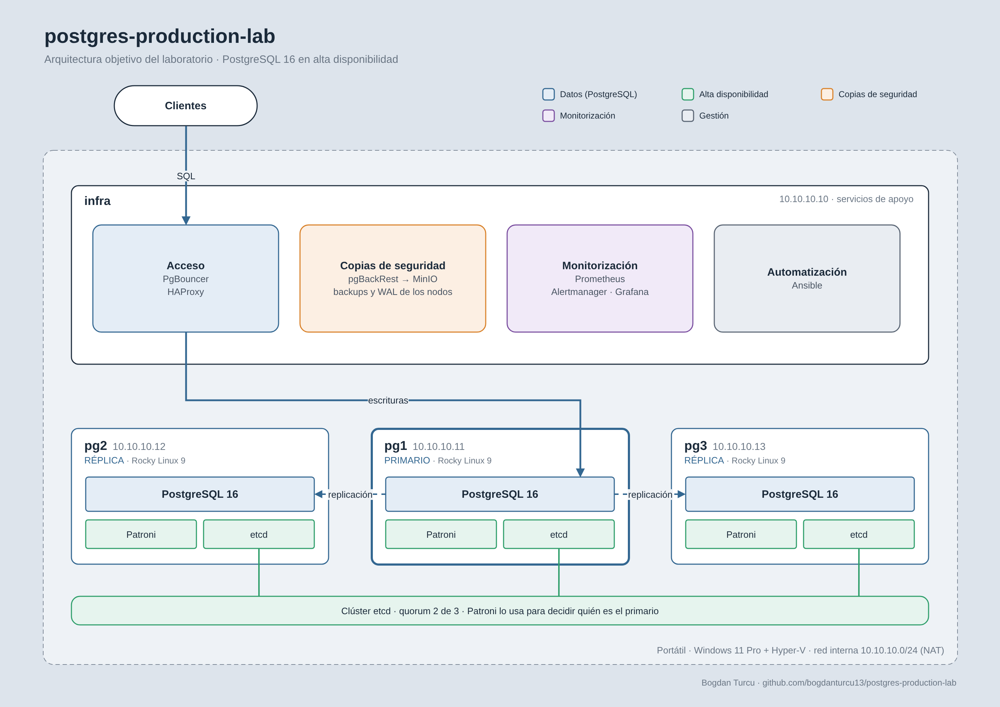

# postgres-production-lab

Laboratorio personal para aprender a administrar PostgreSQL como en producción: montarlo, operarlo y romperlo a propósito para aprender a diagnosticar y arreglar los problemas, como haría un DBA o un SRE.



## Máquinas

| VM    | IP          | Rol |
|-------|-------------|-----|
| infra | 10.10.10.10 | HAProxy, PgBouncer, pgBackRest + MinIO, Prometheus, Grafana, Ansible |
| pg1   | 10.10.10.11 | PostgreSQL 16 + Patroni + etcd |
| pg2   | 10.10.10.12 | PostgreSQL 16 + Patroni + etcd |
| pg3   | 10.10.10.13 | PostgreSQL 16 + Patroni + etcd |

Rocky Linux 9 sobre Hyper-V (Windows 11 Pro), red interna 10.10.10.0/24 con NAT.

## Fases

| Fase | Tema | Estado |
|------|------|--------|
| 0 | Preparación del entorno | Hecha |
| 1 | Instalación y configuración de PostgreSQL 16 | En curso |
| 2 | Replicación | |
| 3 | Alta disponibilidad con Patroni y etcd | |
| 4 | Copias de seguridad y recuperación ante desastres | |
| 5 | Monitorización y rendimiento | |
| 6 | Mantenimiento | |
| 7 | Cambios en producción y actualizaciones | |
| 8 | Incidencias e ITIL | |
| 9 | Automatización con Ansible | |

## Organización

```
docs/
  memoria.pdf        Memoria técnica del proyecto (fuente: memoria.tex)
  apuntes.md         Cuaderno de trabajo, bloque a bloque
  preguntas.md       Preguntas de repaso de cada fase
  arquitectura.png   Diagrama (editable en arquitectura.drawio)
scripts/hyperv/      Scripts de PowerShell para crear el laboratorio
runbooks/            Procedimientos de operación
postmortems/         Informes de incidencias
```

La memoria se compila desde `docs/` con `latexmk -pdf memoria.tex`.
